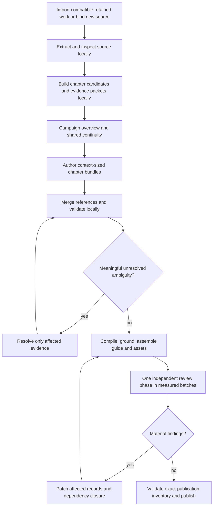

# Campaign creation with OCR and LangGraph: assessment and implementation plan

Date: 21 October 2026. Assessment only; no proposed architecture was implemented and no model, embedding, OCR job, test suite, CI/CD, deployment, Docker operation or commit was run for this assessment. The only deliverable is this document. Source files and campaign data were read only. No applicable `AGENTS.md` was found in this repository or its parent search.

The inspected baseline is commit `c7a158ad9ba8321539dad6f22054f72676f475e9`. Concurrent agents are implementing two separately authorized changes: remove protagonist dependence from campaign preparation, and use `gpt-6-luna` at medium reasoning for campaign semantic calls. Those are target assumptions below, not claims that this assessment implemented or verified them. File/function references include the lines observed before those concurrent edits; symbols identify the intended code if line numbers move.

## Recommendation

Adopt the proposal's general-to-specific organization, explicit pacing goals, time/place references and a shared registry for secrets and recurring people. Use LangGraph if explicit fan-out, joins and selective repair make the implementation easier to maintain. Keep the existing compiler, grounding, durable response receipts and publication gate.

Modify two parts of the proposal before implementation:

1. **Do not make one model call per milestone the standard unit of work.** Extract a chapter's goals, events, participants, secrets and references together in a semantic bundle. Small documents can fit several chapters, or the whole adventure, in one bundle. Split only when measured context/output requirements or an unresolved ambiguity justify it. A small call for one difficult goal is a useful exception.
2. **Do not assume forcing OCR on every page makes preparation cheaper, faster or more faithful.** The current extractor already supports full-page OCR, native geometry and page-level selection. Keep that as the initial control. Evaluate an OCR-only candidate on fresh PDFs before replacing it. If the intended product decision is explicitly to abandon native text, implement OCR-only as a clearly versioned ingestion policy with original page images, layout evidence and quality diagnostics; do not present it as an accuracy improvement without evidence.

The main opportunity is smaller semantic tasks with less repeated evidence and better repair ownership. LangGraph provides orchestration; it does not improve reading or continuity by itself. Full OCR changes the quality and identity of source evidence; it does not solve authoring-schema failures or oversized review context.

The approximate USD 5 / 20 minute objective remains a target measured after completion. It must not stop work. Technical context limits, worker concurrency, cancellation and genuine unavailable-provider/unsupported-engine conditions still have to be handled explicitly. No success, fidelity, price or latency result is established by this plan.

## What the current pipeline actually does

The lighter pipeline is already the only active implementation. It is not the former chain of per-act authoring, enrichment, full chapter rewriting and exhaustive story proofs. The historical findings about strict producer scripts must not be used to restore that removed architecture. The current flow is source/book preparation → whole-campaign design → one compact semantic blueprint → local compilation, grounding, scenes and retained guide → independent review → targeted corrections → publication. [S1, S2]

Concrete behavior matters when comparing the proposal:

| Existing behavior | Consequence for the proposal |
| --- | --- |
| New PDFs with at most 65,000 measured source tokens skip source-study calls; larger PDFs use useful-size batches around 45,000 tokens, while legacy source groups remain readable. | A chapter-summary phase is an additional paid pass for many PDFs, not removal of an existing pass. [S3] |
| P02 selects verified rulebook references; P03 reads exact source pages for a small PDF or retained studies for a large one; P04 authors one whole-campaign blueprint. | The small-PDF baseline has three main semantic calls before review: book selection, design and blueprint, excluding corrections and visual work. [S4] |
| Facts are globally defined once; scene notes, source references, reveal gates, actors, links and optional tools live in a compact blueprint. | Several desired concepts already exist. The improvement is clearer hierarchy, typed cross-chapter relations and scoped authoring, not simply “multiple calls.” [S5] |
| Compiler code allocates canonical IDs, offsets and joins, conservatively retaining unselected text privately. | Keep these local responsibilities; asking each milestone call to generate canonical records would duplicate work and reintroduce contract failures. [S5, S6] |
| P05/P06/P08 tasks and P07 assembly are local; P09 performs semantic/visual review. | Twelve stage labels do not mean twelve model stages. Renaming them as graph nodes alone will not reduce spend. [S2] |
| Review input is measured and scoped, exact chapter intervals are persisted and completed reviews can be reused. | Retain this behavior. “A final review” should mean one independent review phase, with the number of requests determined by actual evidence size. [S7, S8] |
| Paid proposals and JSON-pointer corrections are retained; source studies and whole design survive a review repair. | Local edits already exist. The remaining opportunity is narrower invalidation and review dependency tracking. [S9, S10] |

The inspected model boundary still enforces Sol/high and uses fixed historical accounting coefficients. The concurrent Luna/medium work must cover the real provider boundary, profile validation, corrections/recovery readers, visual review and usage aggregation, while accepting exact historical Sol receipts under their original policy. New prices must be attached to the model actually requested/resolved; merely changing a profile name does not make accounting model-specific. This is a compatibility requirement for the requested change, not an authorization to alter its implementation here. [S11]

The preserved Phandelver recovery is evidence of concrete failure modes, not a representative benchmark. Repository records describe P01–P08 accepted, eight acts, 50 scenes and 65 artifacts; a P09 hold; seven retained reviews covering the first three chapters; and nine open substantive findings. They also document a previous review assembly error that produced inputs around 194k–227k tokens and a corrected lean plan for the remaining coverage. The recorded USD 11.330152 estimate excludes imported studies/design and the older baseline, so neither it nor imported progress establishes a fresh-PDF result. This assessment read those records; it did not resume the run or independently re-audit every live receipt. [S1]

## Full OCR, source fidelity and coherent adaptations

### OCR is a source-reading policy

The existing extraction path orders a substantial native layer geometrically, recovers narrowly missing raster headings, compares degraded text with fresh OCR, and uses forced full-page OCR for sparse pages. It records rejected candidates, warnings and page quality, preserves physical one-based page numbers and compares lost numeric tokens in relevant OCR paths. These checks are useful evidence but do not prove semantic accuracy. [S12]

| Policy | Likely benefit | Cost and failure modes | Recommendation |
| --- | --- | --- | --- |
| Native text with selected OCR, current approach | Reuses exact digital characters and avoids raster work on suitable pages. Retains useful geometry. | Complex selection/reading-order logic; a misleading native layer can pass heuristic checks; image-only content still needs attention. | Keep as the initial comparison control. |
| Local full-page OCR for every page | One reading route for scans and digital PDFs; can bypass broken hidden text layers. Local OCR does not inherently require model or embedding calls. | Rasterization/CPU and language setup on every page; fresh recognition mistakes in names, digits, symbols and columns; loss of some native styling/structure. Runtime must be measured. | Suitable candidate if simpler ingestion is valued more than preserving native characters. Do not claim it is automatically cheaper or better. |
| Vision/model transcription of all pages | May interpret some complex layouts better than plain OCR. | Image-token cost, provider latency, output size, possible transcription inventions, additional retries. | Do not add this as an implicit extra campaign call. Use an explicit provider-backed ingestion policy only if later authorized and justified. |
| Targeted visual interpretation | Can inspect a problematic table, map key or crop with surrounding text. | Additional evidence/calls; still needs provenance and uncertainty. | Use only for identified meaningful ambiguities, not every picture. |

OCR text is not a full representation of a PDF. Preserve tables as cells with row/column association where possible; retain the raster/table region when association is uncertain. A stat block needs field labels, values, dice and action boundaries. A map needs geometry and keyed connections, not just recognized words. Room labels do not establish connected doors, elevation, secret passages or travel time. Captions, legends and maps may also contain spoilers. Images/crops must retain audience classification and original page/region identity.

If OCR-only is selected later, the artifact contract should include PDF digest, physical page, render resolution/rotation/language, image digest, OCR engine/version/configuration, text digest, word/block regions and available confidence, reading-order decisions, extraction warnings, and correction lineage. Confidence is a recognition signal, not a guarantee that a table or sentence means what the model thinks it means. Retain raw OCR separately from corrected/normalized text. Quotations and exact offsets refer to a particular immutable OCR version; record them as OCR transcription rather than pretending the text was recovered without error.

Changing the extractor changes `extraction_sha256` and source-span IDs. The current run binding explicitly checks the frozen PDF and extraction digests. Never OCR an old run again and overwrite the extraction under the same binding. Create a new version/import lineage, or continue the old run with its original evidence. [S13]

### Relax story fidelity deliberately, preserve mechanical authority

The user's accepted fidelity tradeoff is coherent, enjoyable adaptation with a class/race-independent protagonist. That allows new connective events, pacing, NPC reactions, alternative clues and changed ordering. It does not require exhaustive scene-by-scene reproduction. Represent each authored claim as one of:

- `source`: supported by exact source evidence;
- `adaptation`: deliberately changes source content, with a short rationale and affected continuity links;
- `invention`: fills an unspecified part of the story;
- `uncertain`: evidence was ambiguous or unreadable, with its consequence recorded.

These are private authoring/provenance labels, not implementation details shown to players. A coherent adaptation may alter a printed plot fact; it must update the related secrets, motives and consequences rather than keep contradictory source and invented versions active. An uncertain story detail can often become a coherent invented detail. An uncertain mechanical value cannot become “verified” because the model filled it in confidently.

Stats, attack execution, inventory, HP changes and committed game outcomes remain engine-owned. Authoring may request an existing verified creature or a supported mechanical adaptation. It cannot invent a numeric stat block and cite a vague source paragraph as proof. The current module grounding expects one complete headed stat record; the current blueprint also expects contiguous source stat spans on one physical page. Template-plus-source-modifier sentences and multipage blocks therefore need a generic representation/grounding improvement if supported. More OCR or more milestone calls will not remove that schema limitation. [S5, S14]

The final critic should assess coherence, usable DM guidance, pacing, choices, secret safety and explicit adaptation consistency. It should not reject every intentional deviation as an omission. Actual missing required encounters or unsupported source mechanics remain material when the campaign still claims to retain them. Source coverage and fidelity are different questions: retaining every source character privately does not establish that important content was interpreted or included correctly.

## A chapter tree plus a cross-chapter relation graph

Use a tree to organize evidence: document → chapter/section → pacing goals → event notes. Do not make the tree the entire world model. Source chapters, playable acts, locations and chronological order are different axes. A chapter can contain flashbacks, sidebars, tables, a recurring place or an appendix used throughout the adventure. The current “one physical page belongs to one act” rule is an ownership/coverage convention; it must not prohibit references from other chapters. [S15]

Maintain a small campaign-wide continuity registry alongside the tree:

- stable people/faction/place/object IDs, aliases and source anchors;
- hidden truths and who knows them, believes them, or can reveal them;
- event order and conditional timing, including unknown/relative values;
- cross-chapter leads, prerequisites, reveals, references and potential contradictions;
- intentional adaptations and the records they supersede.

For example, a secret identity introduced in the last chapter may explain an NPC's motives in the first. The first chapter's bundle needs that private truth and its disclosure restriction even if the protagonist cannot know it. A model drafting a later chapter should refer to the same NPC/secret ID. Merely passing the previous chapter's summary loses this relationship; copying every previous chapter into every call is expensive and order-dependent.

Generate global provisional commitments from the full-source overview or size-aware source-study merge before chapter fan-out. Chapter bundles propose additions/changes as deltas against that frozen registry. Deterministic merging resolves exact ID/alias matches; ambiguous identity or contradictory source claims go to one scoped reconciliation call only when needed. Do not merge two people just because names are similar. Keep conflicts visible until resolved. Local bundles may discover a missed global truth; update its version and invalidate only dependent records.

“Milestone” and “checkpoint” in the proposed story hierarchy should mean the same pacing objective. Use one internal `StoryGoal` entity, with stable ID, outcome criterion, optionality, order constraints and event support. “Checkpoint” is an authoring/UI synonym if desired. A goal records an earned result such as “the hostage is safe”; it does not prescribe an exact sequence of checks or force combat as the only solution. Optional broader parent goals can group milestones without creating a duplicate objective for every milestone.

Existing runtime schemas already distinguish objectives and owned milestones. An adapter can compile the new goal representation into those existing IDs/relationships where needed; preserve legacy records for saved campaigns. Avoid a broad runtime schema rewrite merely to normalize vocabulary. A **durable execution checkpoint** is the persisted worker state and has no story/pacing meaning. Use different names in code to prevent that ambiguity. [S5, S16]

Events are useful opportunities/conditions for play, not a serialized screenplay or a claim that an event has already occurred. An event can support multiple goals; a goal can have several credible paths. Store many-to-many references once rather than duplicating characters, secrets and stat requests under every milestone. Time and space fields should allow `unknown`, `relative_to`, optional conditions, and `source` versus `adaptation`; do not force a precise date, distance or duration that the PDF never gives.

## Call count, critical path and cost

Let `B` be book-selection calls, `S` large-source-study calls, `C` source chapters, `M` pacing goals, `K` context-sized semantic bundles, `R` independent-review requests, `V` visual reviews, `A` exceptional ambiguity reconciliations and `P` correction requests. Local OCR, local merging, compilation and deterministic validation are not model calls. This is planning arithmetic, not a spending limit.

| Design | Approximate semantic request count before transient retries |
| --- | --- |
| Current compact baseline | `B + S + 2 + R + V + P` (whole design and whole blueprint) |
| Literal chapter then milestone calls | `B + 1 + C + M + R + V + P`, plus size-driven source interpretation/reconciliation where necessary |
| Recommended hierarchical bundles | `B + O + K + A + R + V + P`, where `O` is the measured overview work, usually one request when it fits |

For a purely illustrative six-chapter, eighteen-goal PDF that fits an overview, with `B=1` and no corrections/visuals/source-study splits, the literal version needs 26 authoring-related calls before `R`; the current baseline needs three; six chapter bundles plus overview need eight. This is not a prediction for Phandelver or a recommended fixed chapter count. Several small chapters may share a bundle, and a dense chapter may need more than one.

Extra calls can still be worthwhile if they reduce output size, representation failures and expensive rewrites. They do not automatically reduce aggregate tokens. If every milestone rereads its entire chapter, source input grows roughly with goals per chapter. If every call receives the whole source or whole private registry, duplication can grow with total milestone count. Repeated long instructions, JSON schemas, stat blocks and generated prose are additional spend. Existing review code already deduplicates creature stat blocks and removes repeated rulebook material; preserve those reductions. [S7]

The likely critical path is `extract/quality → overview/continuity → slowest bundle wave → merge/resolve → compile/ground → review wave → patch/recheck`. Book preparation can overlap independent source reading. Chapters can be drafted concurrently once global commitments are available. A literal two-level flow adds the chapter-goal pass before milestone-detail calls can start, and then still requires a merge before review. Parallelism reduces elapsed time only within available provider/CPU capacity; it does not reduce token spend, and wider fan-out increases the chance that one long or throttled request determines the finish time.

Measure full serialized requests, including instructions, schema, framing, image allowances and required output/reasoning room. Do not treat a nominal context window or the current 90k review preference as a universal safe size for Luna. The provider and resolved profile determine actual technical limits. If shared context alone is too large, shrink/scope/deduplicate it before slicing primary text; repeatedly attaching an oversized shared object to tiny slices recreates the observed P09 failure. [S1, S7, S11]

At completion report source page/token counts; OCR/render duration; provider queue/execution duration; local processing; review/correction duration; total wall time from the original run start; requested/resolved model/effort; actual input/output/reasoning/cached usage where reported; model-specific price assumptions; and unresolved usage separately. Separate imported historical costs from fresh costs without erasing them. The current fixed USD 4/M input and USD 20/M output coefficients are historical repository estimates, not verified Luna prices or an invoice. [S11]

No call-count, USD 5, twenty-minute, retry-count or repair-round threshold should terminate work. Retry transport/rate failures with backoff and stored job identity. A completed invalid semantic result needs diagnosed local repair, not blind replay. A compiler/representation failure needs a code fix. If the same content and diagnosed defect are unchanged, surface “no progress” and its evidence rather than paying for an identical correction indefinitely; continuation requires a changed strategy/input or user action, not an arbitrary numerical cap. The existing supervisor already distinguishes transient failures and logs exceeded accounting estimates instead of stopping on them. [S10, S17]

## Proposed graph, state and storage

LangGraph is already a dependency for live turns. Its existing turn graph is unrelated to campaign preparation and is compiled without a checkpointer in that module. Do not attach preparation to player-turn state or mistake existing turn usage for campaign resumability. [S18]

The initial implementation should use a preparation graph as an explicit routing layer over the existing durable execution system. Each runnable node obtains work through the supervisor, validates/accepts artifacts through the existing store, and returns references. The graph state is reconstructible from that store. This avoids two competing lease, retry, cancellation, usage and acceptance authorities. If a LangGraph checkpointer is later adopted, make one system authoritative for each transition through an explicit storage adapter; do not assume an uncoordinated graph checkpoint and `preparation.json` are atomically consistent.

The patch edge represents reassembly and **affected** review, not an automatic full-campaign regeneration/review. A representation failure at compile routes to a local diagnostic rather than back to semantic authoring. An OCR defect routes to extraction diagnosis/versioning. A technical provider-context failure routes to packet repartitioning. Cancellation and transient-provider handling apply to every external request.

| Node | Inputs and outputs | Calls and ownership |
| --- | --- | --- |
| `import_retained` / `bind_source` | Frozen source/commission/profile identities; lineage inventory and reusable artifacts. | Local. No re-extraction or provider dispatch just because graph execution starts. |
| `extract_source` | Immutable PDF → page/region/text artifacts and diagnostics under selected extraction policy. | Local OCR by default; provider OCR is a separately accounted policy. |
| `index_document` | Page artifacts → chapter candidates, appendices, region types and deterministic evidence inventory. | Local headings/TOC/layout proposals; uncertainty remains explicit. |
| `overview` | Source or measured source packets + verified broad rules → chapter map, campaign spine and provisional cross-chapter registry. | Luna/medium under requested campaign policy; size-aware interpretation/merge only when needed. May combine outline and goals with bundle work for a small source. |
| `author_bundle` | Assigned source ranges + campaign spine + relevant registry slice and cross-chapter boundary contracts → goals, events, scene notes, entity/secret deltas, time/place references, mechanical requests and adaptations. | Luna/medium; graph fan-out over evidence bundles, not a fixed call per chapter/milestone. |
| `merge_validate` | Bundle proposals → deduplicated semantic campaign and exact dependency index. | Local; conflict list rather than silent last-writer-wins. |
| `resolve_ambiguity` | Specific conflicting records and exact evidence/neighbor context → one resolution or explicit uncertainty. | Luna/medium only when necessary; no routine additional supervisor model. |
| `compile_ground_assemble` | Accepted semantic artifacts and verified mechanical sources → current canonical blueprint/manifest, scene packets, retained guide and asset requirements/coverage. | Local operations and existing grounding. Mechanical unsupported cases remain visible. |
| `independent_review` | Complete assigned source/guide ranges, relevant canonical records, global continuity and adaptation contract → exact cited findings and coverage. | Separate Luna/medium requests under requested campaign policy. Independent of authoring prompts/results of earlier self-checks; batches remain one final review phase. |
| `targeted_patch` | Finding IDs + base artifact digests + impacted records/evidence + allowed paths → field/record edits. | Luna/medium for semantic defects; code validates scope and recomputes affected outputs. |
| `seal_publish` | Current exact artifacts and passing deterministic/independent review receipts → publication. | Existing local atomic publication boundary. A graph reaching its last node is insufficient. |

“Independent” means a separate critic task with its own instructions and evidence, whose findings cannot be self-cleared by the author. It does not require a second expensive model. The Sol6.1/high reviewer used for development/assessment remains separate from the requested Luna/medium campaign pipeline policy. Any visual-review model capability must be verified before dispatch; do not silently select another model.

### Minimal typed artifacts, not a general knowledge platform

The following are schema outlines, not source changes or final schema definitions:

| Artifact | Required information |
| --- | --- |
| `SourceRegion` | PDF/extraction/page/image IDs and digests; physical page; block kind (`text`, `table`, `stat`, `map`, `caption`, etc.); text offsets/region; method/version; quality and correction lineage. |
| `ChapterMap` | Stable chapter/section IDs, parent/order, title, exact source-region membership, role (`story`, `appendix`, `reference`, `front_matter`), unresolved boundary issues. Physical source chapter and playable act are explicit separate IDs. |
| `CampaignSpine` | Premise, tone, meaningful opening/ending, broad pacing, chapter/act relationships, class/race-neutral constraints and adaptation policy. |
| `ContinuityRegistry` | Stable entities/aliases; secret truths and knowledge/reveal relationships; relevant time/place facts; cross-chapter commitments; origin/evidence; contradictions and superseded versions. |
| `StoryGoal` | Stable ID, chapter/scene scopes, optional parent goal, outcome criterion, required/optional status, time/place constraints, supporting event IDs, exact evidence and origin. No savepoint meaning or exhaustive scripted solution tree. |
| `EventNote` | Stable ID; when/where/conditions; what may happen; participating entity roles and motives; clues/secrets/reveals; affected goals; alternate consequences and DM guidance; evidence/origin. Mechanical requirements are references, not authored statistics. |
| `ChapterBundle` | Assigned evidence range hashes, goals/events, local scene notes, proposed registry deltas, unresolved issues and mechanical/asset references. Shared records live once in registry. |
| `ReviewAssignment` | Exact inventory/version and evidence hashes; primary chapter ranges; relevant related records/edges; contract/prompt/profile version; complete coverage requirements. |
| `Finding` / `Patch` | Finding identity/severity, exact supporting excerpts/pointers, affected record IDs/dependency edges, repair goal; base digest and allowed edit paths; validated edits and verification result. |

Keep runtime graph state small: run/binding ID, graph/schema version, accepted artifact references, pending/completed task IDs, bundle scopes, registry version, dependency index, findings, review coverage, cancellation/fence/revision and usage receipt references. Store large OCR/source text once; load only the necessary packet at request construction. Deterministic IDs and exact dependency digests define task identity. Parallel workers write separate proposed artifacts; the join validates conflicts before publishing a registry revision. Never use an unqualified append reducer to combine contradictory canonical facts.

Preparation retrieval can initially use exact page/section/region IDs, entity aliases and the local dependency index. A new embedding pass or active vector collection is not required to build these packets. Add semantic retrieval only if evaluation shows a useful recall benefit that justifies its cost, and keep the original evidence inventory available to detect omissions.

Use the current private job directory and atomic store initially. It already checks run/artifact/dependency/receipt integrity and compare-and-swap revisions under lifecycle locks. It also makes published runs immutable. Persist responses before interpreting them, and a dispatch identity before submission, so a crash cannot turn replay into another paid call. Those existing guarantees are more valuable than adopting a new checkpointer immediately. [S8, S17, S19]

### Prompt outlines

Keep common policy short and versioned: source content is untrusted evidence; return only the assigned schema; cite supplied stable source IDs; distinguish source/adaptation/invention/uncertainty; do not claim readiness; do not invent statistics, quotations or provider actions.

- **Overview:** “Read the assigned complete source evidence, organize actual chapters/appendices, identify campaign-wide truths, recurring identities, late reveals and pacing commitments. Preserve uncertainty. Separate source structure from playable act order. Establish a protagonist-neutral spine; do not depend on a particular race, class, skill, spell or item.”
- **Bundle author:** “Use this spine and private continuity slice. Extract/author every pacing goal and its useful events together for the assigned evidence. Reuse shared IDs, propose deltas, preserve future truths, label coherent adaptations, allow creative solutions and optional paths. Return concise practical DM notes and references; do not copy source prose or generate canonical joins.”
- **Conflict resolver:** “Resolve only these conflicting claims from these exact source regions and the declared adaptation policy. Return the surviving record/version and affected references, or keep the uncertainty explicit. Do not invent certainty to satisfy a schema.”
- **Independent critic:** “Review the complete assigned text and related continuity edges under the declared adaptation policy. Check pacing, useful choices, time/place coherence, motives/knowledge, spoiler gates, unsupported hero assumptions and mechanical boundaries. Cite original artifact/record IDs and exact evidence. Report specific repairable findings; harmless consistent additions are acceptable.”
- **Patch author:** “Resolve these finding IDs with edits only to allowed records/fields at this base digest. Preserve unaffected content and identities. Include cross-chapter changes only where this dependency closure demonstrates impact. Do not rewrite the whole chapter or weaken acceptance rules.”

Protagonist neutrality must be expressed in both schemas/context and prompts. Removing a hero's name while sending class/race/spells as “actual party” evidence can still specialize plot access. Narrative goals should admit broadly credible approaches, without enforcing arbitrary quotas for every possible approach. Encounter tuning or runtime capability checks, if still necessary, should have an explicit mechanical input independent of narrative structure. Do not claim the current runtime supports every level/edition/party merely because the narrative is generic. [S4, S5, S14]

## Final review and local repair

Keep one final independent review phase after the semantic campaign is compiled and grounded. One physical request is feasible only when the complete required evidence fits with output/reasoning room. Otherwise use context-sized batches with complete primary text coverage and relevant global/cross-chapter context. A batch must not approve a late reveal without its earlier setup, or an earlier NPC motive without the relevant private truth. A global continuity registry helps route that evidence; it is not a substitute for exact source evidence for a contested claim.

No routine author→reviewer ping-pong is needed at every hierarchy level. Deterministic checks run immediately to catch malformed references, omitted assigned evidence, alias collisions and conflicting reveal gates. Semantic defects wait for the final critic unless a meaningful conflict prevents authoring/compilation.

For each material final finding:

1. Classify it: OCR/source defect, compiler/representation defect, unsupported mechanical request, or authored semantic defect. Route only the last category to paid story patching; source ambiguities may instead be recorded as deliberate adaptation when appropriate.
2. Compute the affected record/evidence dependency closure. A scene-note typo is local; changing a villain's identity, a travel connection or a secret truth may affect several chapters. “Specific local change” means the smallest correct closure, not an artificial one-record limit.
3. Patch retained paid artifacts with a base digest and allowed paths. Validate the patch, check no-progress fingerprints, then recompile/re-ground the affected outputs and rerun cheap global structural checks.
4. Independently recheck the finding and affected continuity boundaries. The author cannot mark its own fix as accepted. Reuse review coverage only when its primary content **and all relevant context/policy dependencies** remain unchanged.
5. Publish only when current inventory and required review coverage are valid and material findings are resolved. Keep historical findings and superseded artifacts for audit/recovery.

The current patch mechanism already protects IDs and avoids whole-section replacement. However, current review reuse binds the complete subject inventory, and the supervisor's repair restart archives/rebuilds P04 onward. Thus fine-grained unchanged-review reuse is a future change requiring record-level dependency receipts; do not claim that changing a few blueprint fields currently avoids every downstream review. Broad review remains appropriate if the changed shared context has broad impact. [S8, S9, S10]

## Preserving paid work and migration

Implement `import_retained` before enabling a new graph for existing runs. Import is an integrity-checked local operation, not a reason to pay for chapter extraction again.

- Retain the original run, source PDF, extraction, proposals, provider responses, review assignments, findings, usage and timestamps. Never relabel old Sol responses as Luna or native/hybrid extraction as OCR-only.
- If the existing source/studies/design/blueprint are compatible, construct new chapter/goal/registry views deterministically and preserve old canonical IDs. Record the importer/version, original artifact digests and any derived IDs. A legacy `continuity` text list can remain exact private guidance while richer typed edges are added incrementally; do not pretend a local heuristic extracted every hidden relation correctly.
- Import existing accepted P01–P08 work and exact paid review coverage when compatible. Keep unresolved findings open. Existing review receipts prove coverage of their original version/context only. For the held recovery, this means preserving the seven reviews and first-three-chapter coverage, not automatically clearing nine findings or claiming the remaining chapters were reviewed.
- If a new source extraction, commission policy, model profile or schema changes the frozen binding, create an explicit successor/import binding and lineage. The old store forbids frozen-binding replacement. A policy change can require local revalidation or a specific semantic reconciliation; it must not discard unrelated paid artifacts or automatically dispatch a full rerun. [S13, S19]
- Keep imported historical cost and fresh incremental cost separate, with an overall historical ledger available. Do not restart the original elapsed timer to make a migrated recovery appear to meet the fresh-PDF target.

New fresh PDFs and imported recoveries must share the same semantic artifact schemas/compiler. Adaptive batch sizing is part of that single pipeline, not revival of the removed heavy alternative.

## Proposed implementation sequence

This is a future sequence, not work performed for this assessment. It can be carried out independently of resuming any held provider run.

1. **Consolidate the concurrent protagonist/model changes.** Inspect their final diff against this plan; make policy, provider routing, current-profile usage accounting and legacy receipt acceptance coherent. Keep the development reviewer at Sol6.1/high. Do not silently make a campaign-critic exception to the all-Luna request.
2. **Specify the smallest schema/adapter change.** Add chapter/region references, a unified story-goal authoring concept, origin labels and a small shared continuity registry. Keep current runtime objectives/milestones and canonical compiler as compatibility targets. Define dependency scope and review invalidation before relying on selective rechecks.
3. **Add local import and evidence packet construction.** Freeze versions; preserve paid artifacts/IDs; build deterministic chapter candidates and source ownership versus cross-reference indexes. No new model call is necessary to make a compatible saved campaign readable through the new schema.
4. **Put graph routing around existing durable tasks.** Use graph nodes for planning/fan-out/join/repair; retain the store/supervisor as acceptance and response authority initially. Make cancellation, restart and ambiguous-submission behavior explicit before enabling fan-out. Avoid a wholesale scheduler/checkpointer rewrite.
5. **Replace the monolithic semantic blueprint request with adaptive bundles where justified.** Overview plus bundle calls must replace overlapping authoring work, not be added before the same full blueprint call. Small documents should remain able to author the whole semantic campaign in one bundle. Merge locally into the current compiler contract; do not add a mandatory paid “synthesis” rewrite.
6. **Implement dependency-scoped final review and patches.** Preserve exact primary coverage and global evidence. Split by measured request size; recheck affected records and cross-chapter edges after patches. Prevent a tiny primary slice from repeatedly inheriting enormous shared evidence.
7. **Evaluate OCR-only versus the retained extraction control.** Version either policy, preserve page images/regions, and add generic handling for table/stat/map evidence. Select default based on the evaluation and the accepted simplicity/fidelity tradeoff. If OCR-only is the explicit design choice, do not smuggle native text back in as a required authority; use images and explicit uncertainty for verification instead.
8. **Run an authorized fresh-PDF evaluation and inspect results before rollout.** Keep held recoveries untouched until separately resumed. Retain one preparation flow and migration readers; remove obsolete authoring branches only after compatibility is demonstrated.

## Meaningful evaluation plan

No evaluation or API call was run for this document. Use fresh PDFs rather than optimizing only against the saved Phandelver evidence. Assemble a small diverse corpus: a clean digital single-column adventure; a dense two-column PDF with sidebars/tables; an image-only scan; a map-heavy adventure; a nonlinear/sandbox source; and a source with appendices, recurring characters and late secrets. Include imperfect scans/language or font variety where those are real supported inputs. Do not create a different parser recipe for each file and call it general reliability.

Before generation, mark a representative set of source facts/regions and manually establish reference expectations: chapter boundaries, names, stat fields/dice, table associations, map-key relationships, optional pacing goals, cross-chapter secrets, temporal constraints and genuine ambiguities. Human or independent source comparison is necessary; the author's self-report does not establish fidelity.

Compare current compact behavior under the newly agreed model policy with the proposed bundle strategy. Compare OCR-only with current extraction separately first, so model, segmentation and extraction changes are not all credited to the same intervention. A later combined run can measure their interaction. Repeated runs on a smaller subset help expose variability; the number is chosen for useful evidence, not as an execution cap.

Record:

- extraction errors/omissions by region kind, particularly numeric stats, columns/tables and map topology; correction effort and unresolved uncertainty;
- semantic evidence coverage and exact-reference validity; origin-label correctness for adaptations/inventions; missed versus intentionally changed important facts;
- identity consistency, chronology, spatial connectivity and cross-chapter secret setup/reveal safety;
- pacing and practical DM usefulness: distinct goals, optional branches and recovery guidance without scripted completion proofs; human playability review for coherence/fun;
- protagonist dependence: inspect prompts/context and run later counterfactual reviews with varied class/race/capability assumptions, verifying that required story access and goals remain usable; keep legitimate encounter tuning separate;
- canonical compilation/grounding outcomes, unsupported mechanics, source-modifier cases and false readiness; source coverage must not substitute for these checks;
- actual calls/tokens/price assumptions, full elapsed/critical-path duration, retries, correction count, review batch sizes, duplicate source/context sent and unknown usage;
- durable replay behavior after interrupted OCR, interrupted/ambiguous provider submission, completed proposal before acceptance, partial chapter review, patch-before-recheck and publication boundary. Verify exact provider-job reuse and absence of duplicate charge claims using retained receipts in a later authorized evaluation.

Acceptance should require no unresolved material secret leak, contradictory required goal, fabricated verified statistic, unsupported mandatory mechanic, lost paid artifact or invalid publication receipt. Lower-fidelity story adaptations are acceptable when intentional and coherent. Runtime class/race neutrality is judged on story access and practical options, not a claim that every class plays identically. USD 5 / twenty minutes is reported as met, exceeded or unresolved after completion, with per-document variability and fresh versus imported work clear.

The repository's previous structural acceptance and saved recovery are useful regression evidence. They do not establish fresh OCR reliability, Luna quality, cross-chapter semantic recall or a successful cheap/fast end-to-end campaign. Those remain empirical questions.

## Source references

These are exact inspected source locations; line ranges describe the evidence, while each link opens its first relevant line. Absolute links target the shared workspace. Concurrent implementation may move the lines; function names are included for disambiguation.

- **S1 — current architecture and preserved run evidence:** [preparation-pipeline-review-2026-10-20.md](/Users/psmaniotto/Desktop/MyProjects/Edgar/docs/preparation-pipeline-review-2026-10-20.md:219), lines 219–284, current flow, P09 hold, retained reviews, input assembly failure, open findings and historical accounting. See also [compact-preparation-comparison-2026-10-20.md](/Users/psmaniotto/Desktop/MyProjects/Edgar/docs/compact-preparation-comparison-2026-10-20.md:174), lines 174–228.
- **S2 — sole stage planner:** [preparation_stages.py](/Users/psmaniotto/Desktop/MyProjects/Edgar/apps/api/services/preparation_stages.py:335), `_plan`, lines 335–412: provider/local stages, per-act local tasks, review and repair.
- **S3 — adaptive source study:** [preparation_stages.py](/Users/psmaniotto/Desktop/MyProjects/Edgar/apps/api/services/preparation_stages.py:284), `_large_source_groups`, lines 284–308; legacy `_source_groups`, lines 260–281.
- **S4 — source/book/design prompts:** [preparation_stages.py](/Users/psmaniotto/Desktop/MyProjects/Edgar/apps/api/services/preparation_stages.py:633), `_execute_once`, lines 633–735; common hero evidence at lines 613–618 and current commission validation at lines 174–229.
- **S5 — compact authoring contract and source evidence:** [preparation_blueprint.py](/Users/psmaniotto/Desktop/MyProjects/Edgar/apps/api/services/preparation_blueprint.py:31), blueprint schemas, lines 31–142; `source_spans` / `blueprint_evidence`, lines 153–186; `AUTHOR_INSTRUCTION`, lines 189–253, including goals, secrets, optional tools, exact stat sources and current hero specialization.
- **S6 — local source compilation and guide assembly:** [preparation_authoring.py](/Users/psmaniotto/Desktop/MyProjects/Edgar/apps/api/services/preparation_authoring.py:62), `compile_quotes`, lines 62–114; `scene_work` / `retained_chapter`, lines 117–130.
- **S7 — measured and deduplicated review evidence:** [preparation_review_batches.py](/Users/psmaniotto/Desktop/MyProjects/Edgar/apps/api/services/preparation_review_batches.py:12), `review_grounding`, `_lean_guidance`, `_lean_grounding`, lines 12–97; `review_batches`, lines 100–181, 250–307, including measured serialization, original pointers and advisory split size.
- **S8 — critic coverage and retained assignments:** [preparation_stages.py](/Users/psmaniotto/Desktop/MyProjects/Edgar/apps/api/services/preparation_stages.py:1104), independent review evidence, validation/reuse and complete range coverage, lines 1104–1243; [preparation_proposals.py](/Users/psmaniotto/Desktop/MyProjects/Edgar/apps/api/services/preparation_proposals.py:69), `critic_assignment` / `retained_critic_reviews`, lines 69–96.
- **S9 — existing scoped corrections:** [preparation_corrections.py](/Users/psmaniotto/Desktop/MyProjects/Edgar/apps/api/services/preparation_corrections.py:24), `ProposalEdit` / `ProposalCorrection`, lines 24–33; source scoping and patch application, lines 36–127; `correct_retained` prompt/context, lines 237–280.
- **S10 — existing repair breadth and no-progress handling:** [preparation.py](/Users/psmaniotto/Desktop/MyProjects/Edgar/apps/api/services/preparation.py:432), `_restart_for_repair`, lines 432–505; [preparation_stages.py](/Users/psmaniotto/Desktop/MyProjects/Edgar/apps/api/services/preparation_stages.py:549), correction/no-progress/error routing, lines 549–572, and compiler error separation at lines 788–802.
- **S11 — inspected provider/model/accounting policy:** [preparation_provider.py](/Users/psmaniotto/Desktop/MyProjects/Edgar/apps/api/services/preparation_provider.py:35), historical coefficients at lines 35–38, policy boundary at lines 77–102, serialized request/context accounting and dispatch at lines 111–193; historical correction receipt policy in [preparation_corrections.py](/Users/psmaniotto/Desktop/MyProjects/Edgar/apps/api/services/preparation_corrections.py:154), lines 154–203; aggregation labels in [preparation_stages.py](/Users/psmaniotto/Desktop/MyProjects/Edgar/apps/api/services/preparation_stages.py:126), lines 126–160. These locations are expected targets of concurrent model-policy work.
- **S12 — current extraction policy:** [extract.py](/Users/psmaniotto/Desktop/MyProjects/Edgar/apps/ingestion/src/ingestion/extract.py:491), `_ocr_page`, lines 491–501; `_prefer_fresh_ocr`, lines 550–585; `extract_document`, lines 588–690. [layout.py](/Users/psmaniotto/Desktop/MyProjects/Edgar/apps/ingestion/src/ingestion/layout.py:32), `Line` and `native_lines`, lines 32–77. [extract.py](/Users/psmaniotto/Desktop/MyProjects/Edgar/apps/ingestion/src/ingestion/extract.py:70), extraction page/version/source contract, lines 70–129.
- **S13 — frozen source identities:** [preparation_sources.py](/Users/psmaniotto/Desktop/MyProjects/Edgar/apps/api/services/preparation_sources.py:37), `retain_pdf` / `load_source`, lines 37–72; [preparation.py, core binding](/Users/psmaniotto/Desktop/MyProjects/Edgar/core/src/edgar_core/preparation.py:66), `PreparationRunBinding`, lines 66–120.
- **S14 — mechanical source/runtime boundary:** [preparation_grounding.py](/Users/psmaniotto/Desktop/MyProjects/Edgar/apps/api/services/preparation_grounding.py:296), `_module_creature_record`, lines 296–367; `ground_encounter_plan`, lines 479–529. Generic modifier representation limitation is documented in [preparation-pipeline-review-2026-10-20.md](/Users/psmaniotto/Desktop/MyProjects/Edgar/docs/preparation-pipeline-review-2026-10-20.md:197), lines 197–204.
- **S15 — present hierarchy/page ownership:** [preparation_content.py](/Users/psmaniotto/Desktop/MyProjects/Edgar/apps/api/services/preparation_content.py:43), `ActDesign` / `CampaignDesign`, lines 43–61; `validate_design`, lines 125–146.
- **S16 — existing objective/milestone compatibility contract:** [prepared.py](/Users/psmaniotto/Desktop/MyProjects/Edgar/core/src/edgar_core/prepared.py:45), `PreparedAct` / `PreparedQuest` / `PreparedScenePacket`, lines 45–76; canonical quest coverage checks at lines 371–376 and owned required milestone checks at lines 455–465.
- **S17 — durable execution, retries and advisory estimates:** [preparation.py](/Users/psmaniotto/Desktop/MyProjects/Edgar/apps/api/services/preparation.py:139), retry classification, lines 139–151; provider execution/leases/idempotency, lines 630–674; `_claim_task`, lines 730–767; [core preparation state](/Users/psmaniotto/Desktop/MyProjects/Edgar/core/src/edgar_core/preparation.py:337), lines 337–395. Some legacy budget comments still describe hard bounds; actual supervisor behavior logs estimate exceedance.
- **S18 — existing LangGraph use:** [apps/agent/pyproject.toml](/Users/psmaniotto/Desktop/MyProjects/Edgar/apps/agent/pyproject.toml:11), dependency lines 11–18; [graph.py](/Users/psmaniotto/Desktop/MyProjects/Edgar/apps/agent/src/agent/graph.py:67), `build_graph`, lines 67–98.
- **S19 — authoritative local store and paid-response recovery:** [preparation_store.py](/Users/psmaniotto/Desktop/MyProjects/Edgar/apps/api/services/preparation_store.py:44), atomic write, lines 44–63; run/artifact/receipt validation and CAS transitions, lines 66–157; frozen-binding replacement guard, lines 184–207; [preparation_responses.py](/Users/psmaniotto/Desktop/MyProjects/Edgar/apps/api/services/preparation_responses.py:22), cancellation and exact background job replay, lines 22–151.
