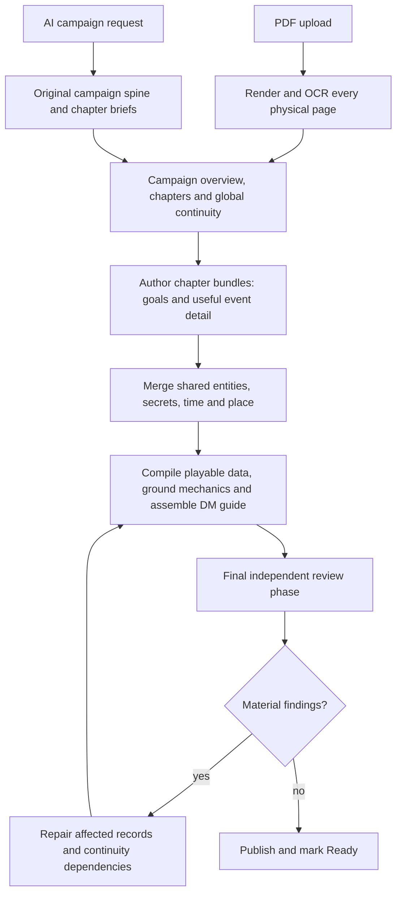

# Campaign preparation replacement plan

Date: 21 October 2026. Status: implementation specification for a new coding agent; not implemented by this document.

## Authority and outcome

Replace campaign preparation with one new LangGraph workflow for PDF campaigns and AI-generated campaigns. This is a rework, not another repair of the current preparation pipeline. Build a new semantic model, graph, prompts and execution flow; connect them to the application and remove the superseded executable implementation in the same change. Do not wrap the old workflow in graph nodes, add another selectable pipeline, retain a legacy execution fallback, or finish by merely tuning existing prompts and validators.

This specification supersedes the implementation direction of `campaign-creation-ocr-langgraph-assessment-2026-10-21.md`. That document is useful background, not a requirement to retain the old orchestrator, authoring compiler, stage contracts or hybrid campaign-PDF extraction. In particular, full-page OCR and a new orchestrator are product decisions here. Their quality and performance still require measurement.

Preserve working combat, character management, playthrough ownership, UI behavior unrelated to preparation, verified rulebook access and persistent user data. Small infrastructure or engine utilities may be reused when they serve the new design without carrying its old assumptions. Simplify or replace old canonical-generation adapters if necessary; do not reproduce the old contracts merely to satisfy their validators.

The implementation belongs on the exact Git branch `dev`. All Edgar-owned Docker image targets must be built from that branch. Continue using one local stack and `http://127.0.0.1:8000/ui/campaigns`, preserving the existing data stores. Do not merge the implementation into `main` during this task.

## Product contract

- A prepared campaign is reusable and independent of any selected hero, character ID, race, class, level, inventory or sheet. The hero chosen later is always the protagonist. Printed/source level recommendations remain campaign information.
- Narrative milestones and checkpoints are one pacing concept: a meaningful outcome, objective and reference for where the player is in the adventure. Internally use one goal representation. A durable execution checkpoint is a separate storage concept.
- A goal such as “the prisoner is safe” must allow the live DM to recognize a credible rescue. Do not require an exhaustive scripted route, a prescribed spell, an exact check sequence, or prewritten outcomes for every possible action.
- Edgar may invent connective events, motives, clues and harmless missing details that fit the campaign's theme, established facts and future developments. A coherent, enjoyable adaptation is acceptable even when it differs from the PDF. Deliberate adaptations must not coexist with contradictory source facts.
- Combat execution, numeric mechanics, HP, inventory and authoritative committed state remain engine-owned. Use verified mechanics or an explicit supported adaptation; do not invent a stat block and call it verified source evidence.
- Every new campaign semantic request uses `gpt-6-luna`, reasoning `medium`, including PDF interpretation, AI generation at every complexity, visual interpretation/review, critics and repairs. No Sol fallback. Embeddings and actual image generation retain appropriate separate model types and truthful accounting.
- Approximately USD 5 and twenty minutes for a complete campaign are measurement goals, not stopping conditions or guarantees. Log actual cost, calls, tokens and elapsed time afterward. Do not add token, dollar, call-count, repair-round or overall preparation-duration caps that terminate otherwise useful work.
- Honor user cancellation. Use actual provider context limits, bounded operational concurrency and recoverable network handling. Connection/read timeouts must support recovery of durable background jobs rather than discard progress or force a new paid submission. Detect unchanged repair results and report the unresolved problem without an infinite paid loop.

## New workflow

### PDF source acquisition

Render and OCR every physical campaign-PDF page, including pages with an existing text layer. The new campaign preparation path does not use native PDF text as its primary source, a required fallback, or a second parallel authoring pipeline. Prefer local OCR; do not implicitly pay a vision model to transcribe every page. Shared rulebook ingestion outside this campaign workflow need not be rewritten merely because campaign ingestion changes.

Retain the original PDF, page images, raw OCR, normalized text, physical page numbers, reading order, region coordinates and quality diagnostics. Version the OCR configuration and source hashes. Keep tables, stat blocks, captions and maps associated with their page regions; OCR words alone do not establish table relationships or map connectivity. Use targeted Luna/medium visual interpretation only where useful evidence cannot be obtained locally. Mark uncertain evidence rather than fabricate exact quotations or mechanics.

Store source material once. Build chapter candidates and evidence packets locally where feasible. Never send the full PDF text independently for every milestone. Long sources must be partitioned by measured context needs while retaining global relationships. Do not retain the old study/design/blueprint chain underneath the new source adapter.

### AI source acquisition

Start directly from the user's premise, theme, desired size/complexity and source-independent preferences. Generate a campaign spine and chapter briefs, with central truths and future reveals, then enter the same chapter-bundle and continuity workflow as PDFs. Do not manufacture a PDF/OCR pass, require an old prepared campaign, or invoke the removed AI outline/chapter generator.

AI campaigns use authored-origin references instead of fabricated PDF citations. They must produce useful playable material and a DM guide, not only a chapter outline. Small campaigns may combine overview and several chapters in one model request when appropriate; this is adaptive batching within the same pipeline.

### General to specific authoring

First establish the whole campaign's premise, chapter structure, broad pacing, major places, recurring characters, global truths and hidden cross-chapter relationships. Separate source chapter order, playable act order and fictional chronology.

Then author context-sized chapter bundles. Each bundle extracts or creates goals and their useful detail together: possible events, NPC participation and motives, secrets, clues, locations, time/order references, optional paths, consequences and mechanical requirements. The hierarchy is general to specific in the artifacts and prompts; it does not mandate a separate LLM call for every tree level or milestone. Several small chapters can share one call. A dense chapter may use multiple packets. Parallelize independent bundles after their shared commitments exist.

Keep a compact global continuity registry with stable identities and aliases, private truths, who knows what, reveal conditions, related goals/events, temporal/spatial constraints and intentional adaptations. Pass each bundle the relevant registry slice, including future secrets that explain earlier behavior. Update shared records through validated deltas and explicit joins; do not silently overwrite conflicting facts or repeat the entire world description in every request.

Use one minimal semantic model, for example campaign spine, chapters, story goals, event notes, entities/places, secret/continuity relations and mechanical references. These are conceptual responsibilities, not a mandate for many tables or a general knowledge-graph platform. Model events as opportunities and conditions for future play, not events that have already happened. Allow unknown/relative time and place details. Keep source, adaptation, invention and uncertainty provenance private and concise.

### Playable assembly and review

Compile stable IDs, engine records, scene/goal references, reusable encounters, maps/handouts where useful, and the DM guide locally whenever possible. Reuse suitable verified mechanics and engine primitives. Preserve source encounter quantities in the reusable module; hero-specific fitting happens during play. Do not ask an LLM to author mechanical joins or repeat the same content as separate design, compiled act, scene-enrichment and chapter-writing calls.

Use versioned prompt files with explicit input/output schemas and examples where helpful. Keep prompts consistent with the schemas actually sent. Separate schema/representation errors from semantic defects: code defects belong in code fixes, not endless paid story regeneration. Avoid arbitrary title lengths, route quotas and narrative proof obligations unrelated to storage or runtime needs. Retain real referential integrity and secret-safety requirements.

Run one independent final review phase after assembly. It may require several measured evidence packets; it must cover the campaign and relevant cross-chapter boundaries. The critic is a separate Luna/medium task, not a second expensive model. Check practical playability, coherent pacing, identities, motives/knowledge, time/place, secret setup/reveal, mechanics and useful DM guidance. Do not reject harmless inventions or deliberate coherent adaptations merely for differing from the PDF.

Return specific findings with stable record IDs, evidence and repair instructions. Patch only the affected records plus their actual continuity/dependency closure, then reassemble and independently recheck that closure. Retain unaffected accepted work and valid review coverage. A changed global secret can affect multiple chapters; a local prose change must not force whole-campaign regeneration. Ready requires valid current playable data, required review coverage and resolved material findings, rather than a graph merely reaching its final node.

## Persistence and removal of the old implementation

Design one authoritative durable state owner for the new graph. Persist node/task identity, source/config/prompt/schema versions, accepted artifact references, dependency hashes, findings, usage and cancellation/recovery state. LangGraph state and durable receipts must not form two independent schedulers. Persist dispatch identity before submission and provider response identity/output before parsing and acceptance. Recover known responses across restarts. An ambiguous submission must be reconciled without blind duplicate generation.

Old campaign data is an archive and comparison baseline, not a requirement to keep the old executor running. Preserve source PDFs, OCR/extraction versions, studies, designs, proposals, background response receipts, reviews, findings, assets, checkpoints, original usage and timestamps. Keep their original model attribution and hashes. Do not auto-resume or rewrite Phandelver during development or deployment.

Keep only the minimal archive/schema readers required to display or access saved records and retain play compatibility. Archive readers must be inert: no old model dispatch, scheduler, automatic startup resume, alternate pipeline selector or hidden fallback. Move necessary compatibility data schemas into a small archive module rather than keeping the old pipeline imported just to deserialize a record. A successor/import operation, if required later, must be explicit and preserve lineage; implementing a broad importer is not a prerequisite for a genuinely fresh campaign run.

Inventory actual callers before removal. Candidate superseded code includes `apps/api/services/preparation.py`, `preparation_runtime.py`, `preparation_stages.py`, `preparation_blueprint.py`, `preparation_authoring.py`, old content/review/repair adapters and executable leftovers in `campaign_generator.py`. Assess associated core contracts, frontend status models, routes, prompts, configuration and obsolete tests/docs. These are inspection targets, not an instruction to delete shared engine code blindly. Extract genuinely useful independent primitives, then delete old orchestration, stage plans, authoring contracts, prompts, tools, flags, branches and unused dependencies. Update all entrypoints to the new graph. There must be one active creation flow when the work is complete.

## Branch, images and data-preserving rollout

Known baseline: primary repository `/Users/psmaniotto/Desktop/MyProjects/Edgar`; `main` implementation baseline `640d7f6`. Verify the current branch and working tree before acting. Preserve preexisting user changes, including deletions of `.claude/launch.json` and `.cursor/rules/Python-developer.mdc`; do not stage, restore or discard them as part of the rework.

Create `dev` from current `main` if it does not exist; if it exists, inspect and continue it without resetting or force-pushing unrelated work. The user explicitly requested the name `dev`, so use that exact name. Commit and push the implementation there with CI skipped. Do not merge to `main` yet.

As verified on 21 October 2026, the active deployment is Compose project `edgar-main`, using checkout `/Users/psmaniotto/.claude-worktrees/edgar-b/edgar-main-run`, `docker-compose.yml` and untracked `docker-compose.local-main.yml`. Its source was detached at `640d7f6`. Reinspect live configuration rather than assuming these observations remain current. Do not print `.env`, credentials or secret-bearing expanded Compose environment output.

Current persistent resources:

| Resource | Existing location/name |
| --- | --- |
| Campaign files, PDFs, jobs, checkpoints, assets | `/Users/psmaniotto/.claude-worktrees/edgar-b/edgar-main-run/data`, mounted at `/data` |
| Index lock directory | Same data directory's `.index-locks`, mounted at `/index-locks` |
| PostgreSQL | Docker volume `edgar-main_postgres_data` |
| Qdrant | Docker volume `edgar-main_qdrant_data` |
| Redis | Existing live service; no persistent mount observed, so preserve required queue/recovery state explicitly before any Redis replacement |
| Public application address | `127.0.0.1:8000` |

Before replacing containers, capture a restorable data backup and manifest: campaign/archive file hashes, a consistent PostgreSQL logical backup, Qdrant snapshots/collection inventory and any required Redis state. Coordinate any active writers/jobs so a filesystem copy is not falsely described as a consistent backup. Record how to restore it and keep secrets out of tracked files. Prefer additive schema migrations; never drop/reinitialize existing user data to make the new design pass.

Use the existing Compose project/resources instead of starting a second stack with empty default volumes. Build from the actual `dev` checkout/commit, with explicit mount/volume mappings if the working directory changes. All Edgar-built targets (`api` including frontend, `ingestion`, `migrate`, and `rules_engine`, plus any replacement application targets) must reflect that same `dev` source, with traceable branch/revision image metadata. Vendor PostgreSQL/Redis/Qdrant images remain infrastructure; they do not have a source branch. Build on-demand job images too, but do not run them just because they were built.

Recreate changed application services on the same stack. Keep the existing data services/volumes, port 8000 and untracked local override unless a concrete necessary change is made safely. Never run volume deletion, broad pruning, destructive resets or a Compose teardown that removes data. Disable legacy startup dispatch so a restart cannot start charging for old checkpoints. Verify running image digests against the built `dev` images, not just a reused image tag. A project still called `edgar-main` can safely run dev-built code; renaming the project is unnecessary and can select different volumes.

## Delivery sequence and evidence

1. Inspect the repository and live mounts; preserve user changes and capture baseline/backup evidence. Switch the implementation to `dev`.
2. Define the new minimal artifact model, graph state authority, prompt files, provider receipt/recovery contract and application boundary. Write a short dependency/removal map. Do not spend the task polishing the old executor.
3. Implement both source adapters, shared hierarchical authoring, continuity merge, local playable assembly, final review and scoped repairs. Make UI creation/status/cancellation/recovery/publication use the new graph.
4. Remove superseded executable code, prompts, paths, flags and obsolete dependencies. Retain only bounded archive readers and useful engine/infrastructure primitives. Update documentation and maintain a concise removal/replacement inventory.
5. Use focused local validation for materially important behavior, imports/schema, frontend build and restart/replay. Do not add or run CI/CD or broad legacy suites. Repair obsolete tests that describe removed behavior rather than using them to justify keeping it. Commit with `[skip ci]` and push `dev`.
6. Build all Edgar-owned image targets from `dev`, deploy the application services on the existing resources, and verify health, UI, image revision and old data/checkpoint integrity after restart. Keep legacy preparations held.
7. Demonstrate a complete fresh PDF campaign from the available adventure corpus without imported studies/design/blueprints, and one small AI-generated campaign. Identify an actual adventure PDF, not a rulebook. Use configured credentials without exposing them. Account for these deliberate validation API calls. Do not silently substitute the old prepared Phandelver output for a fresh run.
8. Verify Ready/publication and a short playable smoke check with a hero chosen afterward. Ensure different hero selection does not trigger preparation. Check durable reuse of a completed response on restart with a local controlled probe; do not intentionally interrupt a costly live request just to create a test case.
9. Report the `dev` commit, running image revision, retained data proof, new prompt/workflow paths, removed legacy paths, fresh PDF/AI outcomes and actual model calls/tokens/cost/time. State any blocker honestly; do not claim the USD 5/twenty-minute goal without measuring it. Leave the old comparison campaign untouched.

Completion means a replacement pipeline working end to end for both fresh input types, no reachable old preparation executor, a dev-built local stack and preserved historical/user data. A new graph diagram, a partial prototype or a successful imported recovery alone is insufficient.
